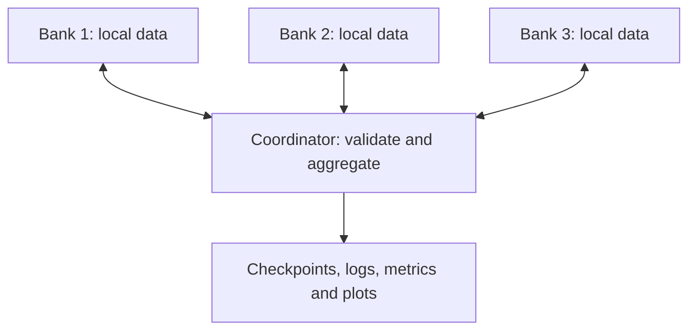

# Resilient Bank Federation

A small CSC3104 project studying whether federated fraud training can keep making
progress when a simulated bank is slow or unavailable.

**One coordinator. Three banks. One small classifier.** Python and Flower handle
training and communication; Docker and Kubernetes provide deployment and recovery.
There is no web application or database service.

## Start here

For the real dataset after cloning, see [Use the real dataset](#use-the-real-dataset).
The quick check below generates synthetic data.

Requires Python 3.11 or 3.12 and [uv](https://docs.astral.sh/uv/getting-started/installation/).
Python 3.12 is the tested version. Commands run from the repository root and work
in PowerShell or a Linux shell.

```text
uv sync --extra dev --python 3.12
uv run bank-fl prepare --synthetic --rows 6000
uv run bank-fl run --rounds 5
```

Synthetic data is for software checks only. The first run can include substantial
PyTorch initialization time. Use the default deadline first, then choose a
deadline from measured healthy runs.

Each run prints its results directory. Substitute that exact path below:

```text
uv run bank-fl evaluate <run-directory>
uv run bank-fl plot <run-directory>
```

The local `run` command uses concurrent workers inside one process. For **real
Flower communication between separate processes**, use:

```text
uv run bank-fl flower --rounds 8 --scenario slow --delay 25 --deadline 20
```

This starts a local SuperLink and three SuperNodes on loopback, submits a minimal
application bundle, waits for results, and stops only the processes it started.
It does not require Docker. Ports 9091–9093 and 9101–9103 must be available.
The local harness is useful for development; use the Flower or Kubernetes
deployment for distributed runtime measurements.

## What the system does



| Mode | When a round commits |
|---|---|
| `resilient` | As soon as at least Q valid banks reply; Q defaults to 2 of 3 |
| `synchronous` | Only after all configured banks reply |
| `timeout` | After all reply, or at the deadline if at least Q valid replies arrived |

The timeout mode is a controlled partial-FedAvg comparison implemented through
the same controller, not a claim to reproduce every default of Flower's stock
strategy.

All modes reject duplicate, stale, mismatched, and invalid model updates.
Sample counts are checked against the prepared manifest. A failed attempt leaves
the model unchanged. Three consecutive failures stop the run. A returning bank
receives the newest model at the next round boundary; its outdated work is rejected.

“Quorum” means a minimum number of contributing banks; this is not a distributed
consensus protocol.

## Useful commands

```text
uv run bank-fl run --mode synchronous --rounds 5
uv run bank-fl run --mode timeout --rounds 5
uv run bank-fl run --scenario slow --delay 40 --deadline 30 --rounds 8
uv run bank-fl run --scenario stale --rounds 5
uv run bank-fl run --scenario unavailable --rounds 5
uv run bank-fl centralized --rounds 5
uv run python -m experiments.run --runtime flower --scenarios healthy slow
uv run pytest
uv run ruff check app experiments k8s tests
```

The `slow` and `stale` scenarios affect one bank at attempt 2 by default.
`--fault-attempt`, `--slow-bank`, `--delay`, and `--deadline` make this explicit.
The selected bank must receive a request in that attempt; check its `dispatched`
event before treating a run as fault evidence. A busy bank can skip an attempt.
`unavailable` leaves the selected bank out for the entire local run.
For Kubernetes pod termination or temporary absence, see [deployment](docs/deployment.md).

To run five banks, prepare a separate dataset first:

```text
uv run bank-fl prepare --synthetic --banks 5 --output data/five
uv run bank-fl flower --data data/five --banks 5 --quorum 3 --rounds 8
```

## Use the real dataset

After cloning, run this from the repository root (requires `uv`):

```text
uv run --python 3.12 bank-fl setup-data
uv run bank-fl flower --data data/ulb --rounds 20
uv run bank-fl evaluate <run-directory> --data data/ulb
```

`uv run` installs the project dependencies if needed. `setup-data` downloads
version 3 of the [ULB credit-card dataset](https://www.kaggle.com/datasets/mlg-ulb/creditcardfraud)
from Kaggle (about 69 MB compressed / 151 MB CSV), checks its pinned SHA-256,
and prepares three banks with seed 42. The public endpoint worked without
credentials when verified. If Kaggle requires login or consent in your environment,
download the file through its website and place it at `data/raw/creditcard.csv`,
then rerun the command. Follow the dataset's published terms and cite its source.

- Raw CSV: `data/raw/creditcard.csv`.
- Real training and evaluation partitions: `data/ulb/`.
- Existing synthetic partitions: `data/processed/` (unchanged).

Rerunning the command reuses a verified CSV and matching prepared partitions.
Different settings, incomplete partitions, or a checksum mismatch produce an
error instead of overwriting existing data. Downloads and preparation use temporary
directories so interrupted work is not published as a finished dataset.
Use `--banks 5 --output data/ulb-five` for a separate five-bank dataset.

Git clone itself does not execute project setup scripts. The command above is the
single post-clone setup step; the dataset remains excluded from Git and Docker.
Training still defaults to `data/processed`, so pass **`--data data/ulb`** for real-data runs.

For a manually supplied compatible CSV, the existing command also remains available:

```text
uv run bank-fl prepare --csv data/raw/creditcard.csv --output data/ulb
```

Preparation removes exact duplicates before a seeded 70/15/15 split, then creates
disjoint banks with different amount distributions. It preserves the original
anonymised feature coordinates and applies `log1p` to Amount. The common class
weight uses training counts only. Every partition must contain both classes;
preparation refuses to overwrite an existing dataset.

These are synthetic institutions, not real retail/private/business bank populations.
The experiment does not detect account-to-account laundering chains.

## Results

| File | Purpose |
|---|---|
| `run.json` | Configuration, data checksum and manifest, versions, host information |
| `events.jsonl` | Dispatch, acceptance/rejection, deadlines and model commits |
| `rounds.csv` | Per-attempt duration, contributors, samples and tensor bytes |
| `model-000.npz`, … | Initial and committed global models |
| `summary.json` | Completion status, timings, participation and rejection counts |
| `evaluation.json` | Validation-selected thresholds; held-out quality and per-bank metrics |
| `comparison.png`, `systems.png`, `comparison.csv`, `aggregate.csv` | Plots, individual results and repeat summaries |

Precision, recall, F1, average precision, ROC-AUC and false-positive rate are
computed offline. **PR-AUC is reported as average precision**, not trapezoidal
integration. Thresholds maximize validation F1; test data is never used for tuning.

Resource samples accompany client replies. CPU/RSS in the local threaded harness
are shared-process observations; network counters outside Kubernetes are
host-wide and must not be summed as independent client measurements. Tensor byte
counts exclude envelopes and transport overhead. Unreturned work is not included
in returned processed-example counts.

## Project map

- `app/`: data, classifier, protocol, coordinator, Flower integration and CLI.
- `experiments/`: repeated runs, pooled baseline, evaluation, plotting and fault injection.
- `k8s/`: a three-bank manifest plus a generator for three or five banks.
- `tests/`: protocol, lifecycle, data, metric and deployment checks.
- [Design](docs/design.md), [deployment](docs/deployment.md), [testing](docs/testing.md),
  [report outline](docs/report-outline.md), and [verification record](docs/verification.md).

Raw training data stays in each bank's mount during FL. Updates are not protected
by differential privacy or secure aggregation. This trusted-cluster prototype
does not defend against malicious participants or provide coordinator failover.
The final article must report those limits and measured results honestly.
