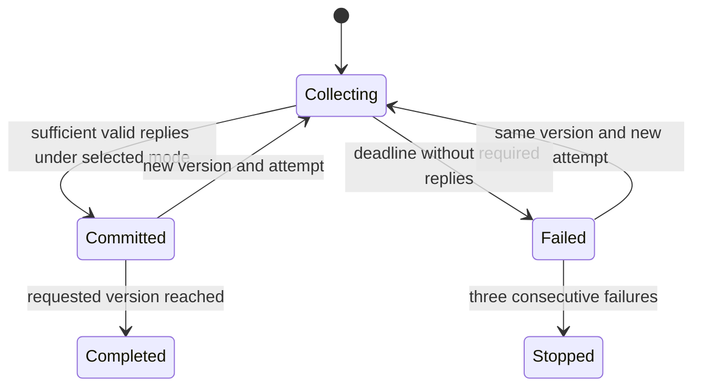

# Design and guarantees

The accepted scope is in `planning/ARCHITECTURE_PLAN.md`. This file describes the
implemented system.

## Runtime

The same `Coordinator` loop works with a concurrent local harness or the Flower
1.22 Message API. Flower uses one SuperLink/ServerApp and one
SuperNode/ClientApp per bank in subprocess mode. Kubernetes therefore needs four
application pods for three banks.

The coordinator uses `Grid.push_messages` and `Grid.pull_messages` to collect
replies incrementally. It does not call a wait-for-all helper for training.
Each client runs a CPU 29→16→1 network with SGD and weighted binary
cross-entropy. Accepted models are averaged using their exact local sample counts.

## Round state

One loop owns all coordinator state. Reply validation checks run ID, attempt,
model version, request ID, bank identity, duplicates, expected sample count, tensor
shape/dtype and finite values. Only successful aggregation increments the model
version. In-flight requests remain tracked across attempts. No bank receives a
second request while an earlier request is outstanding. Dispatch happens once at
the start of an attempt. A returning bank waits for the next attempt, preventing
it from repeatedly starting late and chasing a nearly completed quorum. This does
not guarantee equal participation: consistently slower banks can still be
underrepresented and participation counts must be reported.

The deadline is measured at coordinator receipt time. Replies observed at or
after the deadline are late. All replies in a collected batch are processed
before early closure, so a healthy round can include all three banks.

## Identity and recovery

An identity query binds a configured bank ID to a Flower runtime node ID.
Training replies must match that source node and the original request. When
Flower stops reporting a departed node, discovery may bind its replacement.
Heartbeat detection, application startup and polling contribute to rejoin latency.

The prototype trusts the cluster and its configured clients. The identity query
is not cryptographic enrollment or Sybil protection. A Kubernetes Service gives
the coordinator a stable address; a Deployment replaces failed bank pods.

Clients reload their persisted training partition and use the newly supplied
global model. Interrupted local training is discarded. Client work has a
cooperative time budget checked between batches; transport TTL is slightly longer.
This bounds normal delayed work but does not forcibly interrupt a hung native
library call. Killing a stuck pod remains the operator's recovery mechanism.

## Storage and privacy

Bank containers mount only their own training directory. The coordinator mounts
only the manifest and its result volume. The manifest discloses partition counts,
fraud counts and mean amounts for this public benchmark, including the shared
training class weight; these aggregate disclosures should be stated in the report.
Validation/test data and the centralised pooled baseline are offline experiments.

Checkpoints use an atomic file replacement and never load pickled objects.
Committed checkpoints survive pod replacement on a persistent volume.
Coordinator crashes terminate the current experiment: automatic resumption and
replicated coordinator state are intentionally absent.

## Evaluation boundaries

The default “timeout” baseline models partial aggregation at a deadline through
the same controller. It is not the unmodified Flower stock strategy.
The main claim is applied engineering and evaluation, not a new FL algorithm.

Use identical partitions, initialization, batch/epoch settings and fault schedules.
Compare quality both by global version and elapsed time; early quorum training
may process fewer examples and underrepresent a slower bank.

Validation selects a threshold separately for each checkpoint. The explicit
offline evaluation command computes test curves. Do not repeatedly change
hyperparameters based on those curves.

No numerical speedup or accuracy is assumed. Preserve failed runs and report
their success rate, censored recovery, and any dataset limitations.
