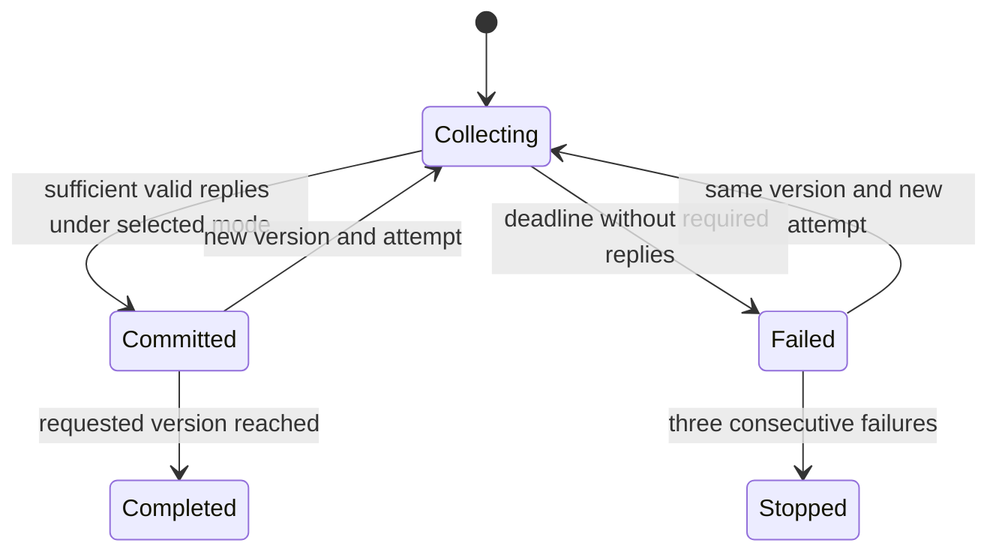

# Design and guarantees

This document describes the implemented runtime architecture and guarantees.

## Runtime

The same `Coordinator` loop works with a concurrent local harness or the Flower
1.22 Message API. Flower uses one SuperLink/ServerApp and one
SuperNode/ClientApp per bank in subprocess mode. Kubernetes therefore needs four
application pods for three banks.

The coordinator uses `Grid.push_messages` and `Grid.pull_messages` to collect
replies incrementally. It does not call a wait-for-all helper for training.
Each client runs a CPU 29→16→1 network with SGD and weighted binary
cross-entropy. Accepted models are averaged using their exact local sample counts.

## Round state

One loop owns all coordinator state. Reply validation checks run ID, attempt,
model version, request ID, bank identity, duplicates, expected sample count, tensor
shape/dtype and finite values. Only successful aggregation increments the model
version. In-flight requests remain tracked across attempts. No bank receives a
second request while an earlier request is outstanding. In the resilient and
timeout modes, dispatch happens once at the start of an attempt. A returning bank
waits for the next attempt, preventing it from repeatedly starting late and
chasing a nearly completed quorum. This does not guarantee equal participation:
consistently slower banks can still be underrepresented and participation counts
must be reported. Synchronous mode needs every bank, so it also dispatches during
an attempt to a bank whose earlier request has just cleared. One slow reply
therefore costs the synchronous baseline one failed attempt, not two.

The deadline is measured at coordinator receipt time. Replies observed at or
after the deadline are late. All replies in a collected batch are processed
before early closure, so a healthy round can include all three banks.

Resilient mode adds a short grace window (`grace`, default 3 s). Once the quorum
is reached, the round stays open until every bank sent work in that attempt has
replied, the grace window ends, or the deadline passes, whichever is first. It
never waits for a bank that was offline or not sent work, so a failed bank costs
at most the grace window per round. Without it, the third bank's update was
discarded as stale in about half of all rounds, although it typically arrived
less than a second after the quorum (median 0.8 s, maximum 2.2 s across two
30-round runs on 26 Oct and 5 Nov). Each commit records `seconds_after_quorum`,
so the cost of the window can be measured. `grace=0` restores closing on the
first quorum.

The same window applies once at startup. Training may begin once the quorum of
banks has connected, but the coordinator first waits up to `grace` for the rest,
because bank pods connect a moment apart (bank-3 connected 1.5 s after the
others in the 6 Nov run and missed round 1). A bank that is really missing delays
startup by at most `grace`.

## Identity and recovery

An identity query binds a configured bank ID to a Flower runtime node ID.
Training replies must match that source node and the original request. When
Flower stops reporting a departed node, discovery may bind its replacement.
Heartbeat detection, application startup and polling contribute to rejoin latency.

The prototype trusts the cluster and its configured clients. The identity query
is not cryptographic enrollment or Sybil protection. A Kubernetes Service gives
the coordinator a stable address; a Deployment replaces failed bank pods.

Clients reload their persisted training partition and use the newly supplied
global model. Interrupted local training is discarded. Client work has a
cooperative time budget checked between batches; transport TTL is slightly longer.
This bounds normal delayed work but does not forcibly interrupt a hung native
library call. Killing a stuck pod remains the operator's recovery mechanism.

## Scheduled retraining

A `scheduled-training` CronJob starts a new 20-round federated run every Sunday at
02:00 Singapore time (`app/scheduled.py`). It reaches the coordinator through the
same Service as the banks, so it needs no port-forward. `concurrencyPolicy: Forbid`
stops a second scheduled run from starting while one is still training,
`backoffLimit: 0` reports a failed run instead of retrying it, and a one-hour
`activeDeadlineSeconds` bounds a stuck run. Results go to the coordinator's
persistent volume like any other run.

Weekly is a design choice: fraud labels arrive late (chargebacks and
investigations), so retraining daily adds little newly confirmed fraud. The
prototype's bank data is fixed; a real deployment would load each bank's latest
labelled transactions. The CronJob does not coordinate with manually started
runs, so operators should not start a demo run during a scheduled one.

## Resource measurement

`demo setup` installs Kubernetes metrics-server from a pinned manifest
(`k8s/metrics-server.yaml`, v0.9.1, with `--kubelet-insecure-tls` because kind's
kubelet certificates are self-signed). During a demo run, `app/resources.py` reads
the metrics API every 5 s and records each new per-pod CPU and memory measurement
to `resources.csv`; metrics-server itself refreshes about every 15 s, so that is
the real resolution. After the run, `resources.json` holds the mean and peak per
role and `figures/resources.png` plots them with kills marked. A replaced bank
pod keeps its role, so its old and new pods form one series. These are the
cluster's measurements of whole pods, unlike the per-process samples that bank
replies carry. Measurement is optional: if metrics-server is missing, training
runs normally and the files are simply not written. Scheduled CronJob runs are
not sampled, because the sampler runs with the operator's `demo start`.

## Storage and privacy

Bank containers mount only their own training directory. The coordinator mounts
only the manifest and its result volume. The manifest discloses partition counts,
fraud counts and mean amounts for this public benchmark, including the shared
training class weight; these aggregate disclosures should be stated in the report.
Validation/test data and the centralised pooled baseline are offline experiments.

Checkpoints use an atomic file replacement and never load pickled objects.
Committed checkpoints survive pod replacement on a persistent volume.
Coordinator crashes terminate the current experiment: automatic resumption and
replicated coordinator state are intentionally absent.

## Evaluation boundaries

The default “timeout” baseline models partial aggregation at a deadline through
the same controller. It is not the unmodified Flower stock strategy.
The main claim is applied engineering and evaluation, not a new FL algorithm.

Use identical partitions, initialization, batch/epoch settings and fault schedules.
Compare quality both by global version and elapsed time; early quorum training
may process fewer examples and underrepresent a slower bank.

Validation selects a threshold separately for each checkpoint. The explicit
offline evaluation command computes test curves. Do not repeatedly change
hyperparameters based on those curves.

No numerical speedup or accuracy is assumed. Preserve failed runs and report
their success rate, censored recovery, and any dataset limitations.
