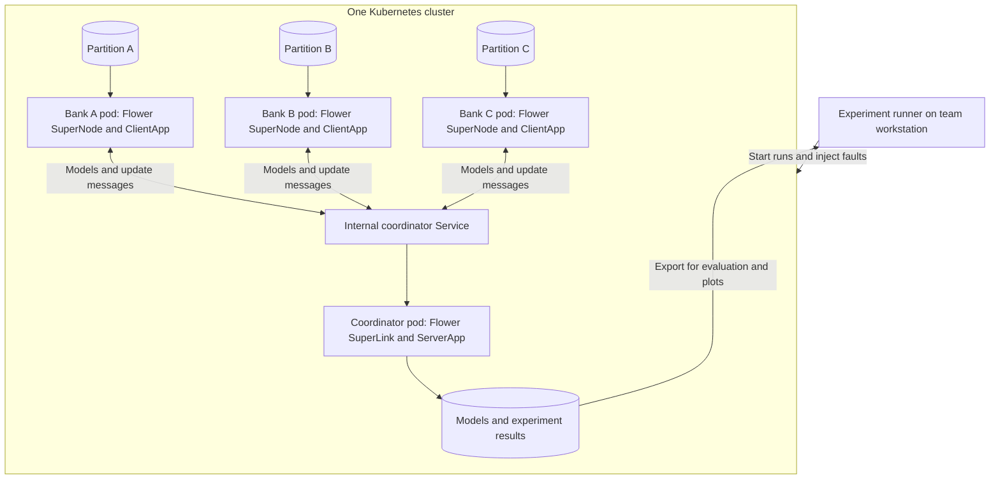

# Group 18 — architecture and delivery plan

**Status:** proposed design for review; no implementation started.

**Prepared:** 20 October 2026, Singapore time.

**Project:** Resilient Cloud-Native Federated Learning for Cross-Bank Fraud Detection.

## 1. Recommendation

Build a small experimental system: **one coordinator and three simulated banks**, running as four application pods in Kubernetes. Each bank trains the same small fraud classifier on its own partition. The coordinator combines model updates and continues when two valid banks have replied, even if the third is slow or unavailable.

The deliverable is a reproducible distributed-computing experiment with a terminal demonstration and comparison graphs. It does not need to become a banking product.

Keep Python, Flower, Docker, Kubernetes, FedAvg, heterogeneous datasets, and the three reliability mechanisms promised in the proposal. Use ordinary files for datasets, checkpoints, and results. The main custom work is a small round controller.

## 2. Sources and requirements

The supplied folder and its Resources subfolder contained:

- [Project_2026-27.pdf — assignment specification and assessment rubric](https://drive.google.com/file/d/1gFPIpk760Ri668i0o_9dNI3dYI1XLkUc/view?usp=drivesdk).
- [GROUP18 — team proposal](https://docs.google.com/document/d/1VXJU36xAENeyD7RkF9iF-GNSNKM3QaxZKz8ODij996g/edit?usp=drivesdk). This is a native Google Doc, rather than a separate DOCX file. Its text, reference links, and Figure A1 were reviewed. No comments were returned.

There was no separate rubric file in those folder listings; the rubric is in the assignment PDF. Text extracts are saved beside this plan for reference. The Drive originals and synced sources are unchanged.

| Source requirement | Minimal planned response | Evidence |
|---|---|---|
| Cloud-native distributed implementation | Separate bank and coordinator processes in Docker/Kubernetes | Deployment manifests, live pods, communication logs |
| Original contribution with related-work comparison | Early quorum completion, explicit version checking, and evaluation under client failures | Small controller, comparison table, measured experiments |
| Concurrency and failure handling | Concurrent bank training; one coordinator owns all round state | Tests around simultaneous, duplicate, and late replies |
| Proposal: Python and Flower | One Python package with Flower ServerApp and ClientApp | Reproducible pinned environment |
| Proposal: FedAvg | Sample-count-weighted model averaging | Hand-calculated aggregation test |
| Proposal: heterogeneous banks | Fixed, disjoint partitions with different transaction-amount distributions | Per-bank size, amount, and fraud-rate summary |
| Proposal: baseline comparisons | Centralised training and strict synchronous FedAvg | Identical model, data split, evaluation protocol |
| Proposal: failure/scaling evaluation | Slow, killed, absent clients; three and five banks | Scenario configurations and result tables |
| Quantitative report | ML quality, timing, recovery, participation, resource and communication measurements | CSV files and reproducible plots |
| Testable submission | Setup, healthy run, fault run, expected outcomes, cleanup | GROUP18_INSTRUCTIONS.pdf |

The project is worth **30% of the module**. Within the project, the weights are proposal **17%**, progress presentation **15%**, implementation **25%**, video presentation **18%**, and article **25%**. A sophisticated GUI is explicitly unnecessary. Advanced features are examples for consideration, not a requirement to add serverless services or a large technology stack.

Final deliverables: source/image or repository URL; **GROUP18.pdf**; **GROUP18_INSTRUCTIONS.pdf**; and a **10–15-minute video**. The article is approximately **3,000 words**, at most **six pages**, in IEEE or ACM proceedings format, with an abstract of at most **200 words**.

The PDF gives the final deadline as **15 November 2026 at 23:59**. It labels the progress presentation “Tuesday, 29 October 2026”; **29 October is a Thursday**, so its date/day conflict needs checking against LMS. Do not silently choose a replacement date.

## 3. Architecture



Arrows show logical exchanges. Flower's node runtime handles the underlying transport. A Kubernetes **Service provides the stable address**; the coordinator code executes in a **pod**, correcting the slightly ambiguous wording in Figure A1.

| Component | Responsibility | Deliberate limit |
|---|---|---|
| Coordinator | Distribute current weights, validate replies, close rounds, aggregate, save results | One active instance; no leader election |
| Bank client × 3 | Read only its partition, train locally, reply with weights and metadata | Same program with different bank ID and data path |
| Experiment runner | Choose scenario, start run, inject documented failures, collect results | A command-line script, not another server |
| Offline evaluator | Load checkpoints and held-out data; produce metrics and figures | No persistent inference API |
| Kubernetes | Discovery, restarts, resource limits, data mounts | One namespace and ordinary manifests |

Use Flower **subprocess mode** so ServerApp/ClientApp run with their corresponding SuperLink/SuperNode containers. This keeps the normal experiment to four application pods; Kubernetes itself has additional system components. One application image can serve both roles through different startup commands.

Suggested stack: Python, Flower, CPU-only PyTorch, NumPy/pandas, scikit-learn for evaluation, Matplotlib for plots, and lightweight resource sampling. Pin compatible versions after an initial deployment smoke test. Do not combine examples from different Flower API generations.

Development target: local Minikube. Final cloud demonstration target: the same manifests on a single-node Kubernetes installation on an available school/cloud Linux VM. No managed-cloud dependency is necessary. VM access and capacity remain unverified; a local cluster demonstrates container orchestration but does not by itself establish a public-cloud deployment.

## 4. Exact round behaviour

Proposed initial settings: **N = 3 banks**, **Q = 2 required replies**, **20 committed rounds**, **one local epoch** per participation. The deadline is configurable; choose and freeze it using healthy pilot timings before fault experiments.

1. Start an attempt with a unique run ID, attempt ID, and current model version.
2. Send the model and training configuration concurrently to eligible banks. A bank has at most one outstanding training request.
3. Collect replies incrementally. Validate run, attempt, base version, assigned bank identity, expected tensor shapes, finite values, and a positive sample count.
4. Accept at most one reply per bank per attempt. A duplicate does not count toward Q.
5. On receiving Q valid replies, immediately close the accepted set. If several replies were observed in the same collection batch, include all valid ones in that batch.
6. Apply FedAvg using each accepted bank's training sample count as its weight. Save the new checkpoint and increment the model version once.
7. If the deadline arrives with fewer than Q valid replies, record a failed attempt and keep the model unchanged. Start a fresh attempt; stop with an explicit insufficient-quorum result after three consecutive failed attempts.
8. Drain outstanding replies and reject anything from closed attempts or older models. A delayed client finishes or times out, then can receive the latest model in a later round.

The coordinator's single event loop owns these state changes, avoiding a race between the deadline and the final reply. Training happens concurrently in the bank processes.

**Do not reduce Q automatically when clients disappear.** With three banks, one unavailable bank is tolerable; two unavailable banks must prevent aggregation. The system should terminate clearly rather than hang or silently lower its correctness condition.

Track outstanding work until completion or transport expiry. A timeout or early round closure does not necessarily cancel client computation. Expired work must not accumulate into an unbounded per-bank queue. Recovered clients receive the newest model rather than restoring a half-trained local model.

### What is actually custom

Flower's documented `send_and_receive` waits for all replies or a timeout. Its `push_messages` and `pull_messages` interfaces allow incremental collection, which is the planned basis for early quorum completion. The first implementation milestone must verify this behaviour on the pinned release before further development.

Timeouts alone are not a novel contribution, and Q-of-N aggregation is **not consensus in the Raft/Paxos sense**. Describe the project as an applied implementation and evaluation of quorum completion, stale-response handling, and Kubernetes client recovery under heterogeneous data.

Protocol fields: run ID, attempt ID, base model version, stable bank ID, request ID, sample count, weights, and training duration. Bank identity is bound to the configured node identity; a self-reported string alone must not count as a separate bank.

## 5. Data and model

Proposed dataset: [ULB credit-card fraud dataset](https://www.kaggle.com/datasets/mlg-ulb/creditcardfraud), subject to verifying download access and redistribution conditions. The proposal does not prescribe a dataset.

Use its anonymised numeric features and transaction amount. Create three synthetic institutions with lower-, higher-, and mixed-amount distributions. These are experimental distributions, not verified real retail/private/business bank populations. Do not claim to detect cross-bank laundering chains from a table without account-linkage information.

Preparation protocol:

1. Identify and handle exact duplicates before splitting.
2. Make a seeded stratified 70/15/15 train/validation/test split.
3. Partition each split using the same documented amount-biased assignment rule; partitions are disjoint and retain sufficient fraud cases to evaluate.
4. Record partition counts and fraud prevalence; reject unusable partitions rather than silently changing the test set.
5. Keep the existing anonymised feature coordinates; use a fixed transform such as log1p for non-negative Amount. Avoid separately fitted client scalers that make averaged parameters refer to different coordinates.
6. Use one small CPU model, initially a **29 → 16 → 1 neural network**, with a fixed weighted binary classification loss. Choose any shared class-weight setting using training information only, and record the aggregate counts disclosed for that purpose.
7. Select the classification threshold using validation data only. Keep test prevalence natural and the test set untouched until final evaluation.

Bank training pods mount only their own training partition. The offline centralised baseline may pool the public training partitions; clearly label that as a comparison experiment. An offline evaluator may hold the public benchmark's reserved validation/test data. Neither should be described as private bank training data moving through the FL protocol.

Reusing a public dataset's existing anonymisation/preprocessing and random splitting limits real-world conclusions. This is a benchmark study of runtime resilience, not a validated banking deployment.

## 6. Storage, deployment, and boundaries

- One namespace; one coordinator Deployment; one single-replica Deployment per bank; one internal coordinator Service; one configuration source.
- Separate bank data volumes and a coordinator output volume. The data survives replacement of a bank pod. Never bake the complete dataset into the common image.
- Configure startup/readiness/liveness checks and CPU/memory requests and limits. Health checks assess process health, not whether a long training operation finished quickly.
- Initial sizing assumption: each bank up to one CPU and 1 GiB RAM, adjusted after a measured pilot. Record actual limits and host specifications in results.
- Retain the last committed model and structured logs outside ephemeral container storage. Single-node volume arrangements do not imply node-failure tolerance.
- No external ingress. Operate on a trusted local/private network; if crossing untrusted networks, use Flower's documented TLS setup before deployment.
- Keep infrastructure administrative access with the operator. Bank containers do not need permission to administer Kubernetes.

The coordinator remains a single point of failure. Saving checkpoints preserves evidence and enables a controlled restart, but transparent coordinator failover is outside this study.

Model updates can disclose information. The defensible privacy claim is **raw training records remain local during federated training**. Differential privacy, secure aggregation, malicious-client defence, and banking-grade tenant isolation are outside scope.

## 7. Experiments and acceptance criteria

Required comparisons:

- **Centralised:** same model trained on pooled public training data.
- **Strict synchronous FedAvg:** require all configured banks; use the same finite deadline so failures produce measurable failed attempts.
- **Resilient FedAvg:** early Q-of-N completion with the validation rules above.

Add one small control comparison on the healthy/slow scenarios: **ordinary timeout-based partial FedAvg** using the same valid-update minimum. This distinguishes the early-completion benefit from timeout support that Flower already provides. It is a configuration/control run, not a new subsystem.

| Scenario | Setup | Required observable result |
|---|---|---|
| Healthy | All three banks available | Valid models and repeatable metrics |
| Straggler | Delay one designated bank beyond the usual completion time | Resilient mode can commit before its reply and before the deadline |
| Pod terminated | Delete one bank pod during training | Other two can commit; replacement pod reconnects and later participates |
| Temporary absence | Scale one bank to zero for a fixed interval, then restore it | Continued quorum progress and documented rejoin |
| Stale/duplicate reply | Deliberately deliver an old-version or duplicate test response | Rejection logged; accepted count and committed weights unchanged |
| Quorum unavailable | Leave only one of three banks available | No invalid aggregation; bounded failure outcome |
| Scale | Repeat with five banks and Q = 3 | Record resource, communication, time, and quality differences |

Use three seeds for the primary comparisons. Run all healthy/slow/terminated/absence scenarios with three banks; use healthy and slow cases for the five-bank scaling check. Treat stale/duplicate/quorum-unavailable cases as deterministic correctness tests, avoiding a needlessly large experiment matrix.

Fairness controls: same data partitions, initial weights, model, local settings, frozen deadlines, hardware limits, and fault schedule. Compare quality both by committed round and by elapsed time. Record total processed training examples because early completion may use less data. Rotate the slow bank across seeds to expose bias against its data distribution.

Record:

- **Quality:** precision, recall, F1, PR-AUC (state the exact calculation), ROC-AUC, false-positive rate; also per-bank test recall where class counts permit.
- **Progress:** attempted/committed rounds, success rate = committed / attempted, round duration, total duration, and deadline failures.
- **Recovery:** fault-to-ready time and fault-to-next-accepted-update time, with censored cases if the bank does not return before the run ends.
- **Participation:** accepted updates per bank; rejected stale/duplicate/invalid replies and reasons.
- **Resources:** sampled CPU and memory for the container's processes, with sampling interval and metric definition recorded.
- **Communication:** serialised application payload bytes plus per-pod interface byte-counter deltas where available. Keep these separate: payload size excludes transport overhead; interface counters include runtime traffic. Sum sent bytes for an overall transfer estimate to avoid double-counting both endpoints.

Retain run configuration, seed, software versions, dataset checksum, model files, event log, round CSV, and final metrics. Plot round time/success, model quality versus elapsed time, recovery/participation, and resource/communication comparisons. Show variability rather than selecting the best run.

No accuracy or speedup target is promised in advance. Success means implementing the advertised behaviour and honestly measuring its trade-offs, including potential quality loss when the same bank is repeatedly excluded.

## 8. Minimal planned repository

This is a proposed layout only; these implementation files have not been created.

```text
README.md
pyproject.toml
Dockerfile
app/
  server.py          # Flower entry point and coordinator
  client.py          # shared bank behaviour
  rounds.py          # quorum, deadline, version validation
  model.py           # one classifier and training routine
  data.py            # split, partition, load
experiments/
  run.py             # scenarios and fault injection
  evaluate.py        # centralised comparison and model metrics
  plot.py
  scenarios.yaml
k8s/
  ...                # namespace, workloads, service, mounts
tests/
  ...                # protocol, aggregation, data and integration tests
docs/
  design.md
  testing.md
  report-outline.md
data/                 # generated/private mounts, not committed
results/              # generated experiment evidence
```

Do not add a website, login system, REST service, relational database, Redis, Kafka, service mesh, separate monitoring platform, GPU stack, multiple cloud providers, or automatic scaling. Leave FedProx as optional future work, as the proposal already permits.

## 9. Delivery sequence

| Stage | Proposed window | Completion gate |
|---|---|---|
| Review and feasibility | 20–22 Oct | Agree scope; dataset accessible; pinned Flower deployment and incremental replies verified |
| Working baseline | 23–25 Oct | Three clients train; centralised/synchronous results available |
| Resilience and demonstration | 26–28 Oct | Quorum, stale checks, killed-pod recovery, and terminal demonstration work |
| Progress presentation | Verify LMS date | 5–10 minutes; each member can explain a contribution |
| Controlled evaluation | 30 Oct–5 Nov | Repeated runs, traceable CSVs, comparison plots |
| Article and instructions | 6–10 Nov | Complete six-page draft and independent setup walkthrough |
| Final verification/video | 11–14 Nov | Fresh-environment reproduction; 10–15-minute recording; package checked |
| Submission | 15 Nov, before 23:59 | Four required deliverables ready |

Suggested six-person responsibility split: coordinator/protocol; bank training/model; dataset and baseline; Kubernetes/recovery; experiments/tests; report/video/reproducibility. Assign names within the group. Each owner should also review an adjacent component and retain evidence for the individual progress presentation and peer evaluation.

The first implementation gate is deliberately small: demonstrate that a round closes after two valid replies while the third remains outstanding, and that the third can later rejoin. If the pinned Flower runtime needs a different adapter, resolve that before adding other functionality.

## 10. Report and demonstration

Report structure: abstract; motivation; design; implementation and failure semantics; evaluation; related work; conclusion/limitations; references. Allocate most space to the mechanism, experiments, and the originality argument.

Update the proposal's references before the final article: reference [4] is a descriptive placeholder with a hyperlink, not a complete bibliographic entry. The verified Micro-FL title is “Micro-FL: A Fault-Tolerant Scalable Microservice-Based Platform for Federated Learning.” Compare it carefully without claiming that this project is the first to handle client failures.

The demonstration should show:

1. Three bank pods and one coordinator running.
2. Healthy federated training and model quality.
3. A slow bank causing strict synchronous training to miss its deadline.
4. Resilient mode committing with two banks.
5. A bank pod being terminated and replaced.
6. The recovered bank contributing again.
7. A stale response being rejected.
8. Measured comparison graphs and the system's limitations.

A terminal event such as “attempt 7 committed; model 6 → 7; accepted A/B; C pending” is sufficient to make behaviour visible. Any displayed values must come from actual logs.

## 11. Remaining facts to verify

These do not prevent reviewing the design:

- Correct progress-presentation date from LMS.
- Available machine/VM capacity and whether the lecturer expects a remotely hosted demonstration.
- Dataset access and redistribution terms.
- Compatible pinned Flower/Python/PyTorch versions and runtime recovery behaviour.
- Final bibliographic details for the proposal's linked 2026 research reference.

No application code, container build, cloud deployment, or Drive edit has been performed for this plan.

## Technical references checked

- [Flower Grid: incremental message collection and timeout semantics](https://flower.ai/docs/framework/ref-api/flwr.serverapp.Grid.html).
- [Flower subprocess deployment: reducing container count](https://flower.ai/docs/framework/main/en/docker/run-as-subprocess.html).
- [Flower network communication and isolation](https://flower.ai/docs/framework/main/en/ref-flower-network-communication.html).
- [Kubernetes pod lifecycle](https://kubernetes.io/docs/concepts/workloads/pods/pod-lifecycle/).
- [Original FedAvg paper](https://proceedings.mlr.press/v54/mcmahan17a.html).
- [Micro-FL research paper](https://www.mdpi.com/1999-5903/16/3/70).

The architecture and defaults above are recommendations, not additional requirements imposed by these references.
